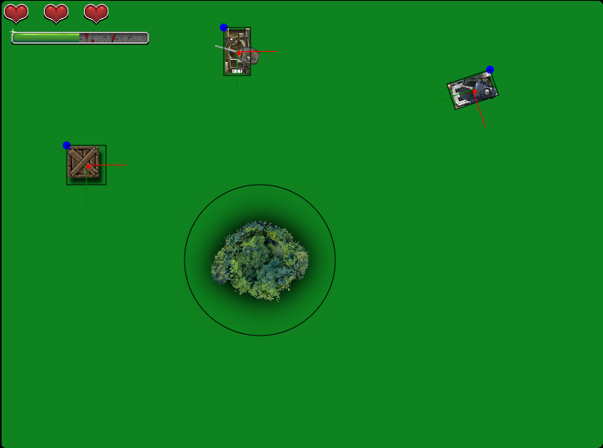

# Documentation #

Documentation for GDV4001 Game System Fundamentals

## YOUR GAME’S TITLE ##

(Insert evocative cover image here)

**Student Name:**

**Academic Year:** 2025-2026

## Index ##

1. [Game Design Document (GDD)](GDD.md)
2. [Technical Design Document (TDD)](TDD.md)
3. [Closing Kit (CK)](CK.md)
