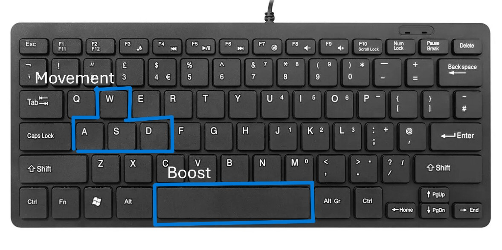
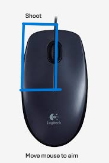
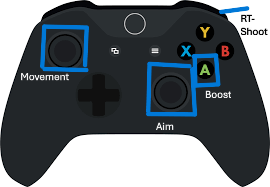
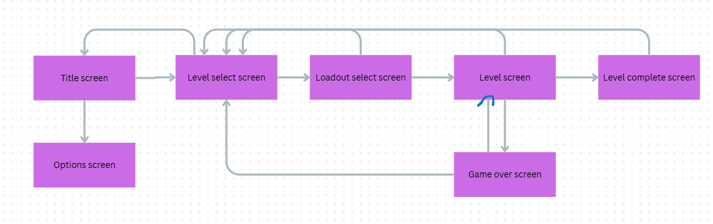

<!-- Based on:  Bonus Level 3, LevelUP: The Guide to Great Video Game Design by Scott Rogers and other examples. 

Note: Sections marked **Optional** options for this assignment, depending on your project some of these areas may be required to explain your mechanics. 

Note: Some sections are marked **If Applicable** these may be required depending on your game!

-->

# Game Design Document (GDD) #

# Skyshard #

Document version number: 1.0

Written by: Noah Pearson

Point of contact: st20326271@outlook.cardiffmet.ac.uk

Date of publishing: 05/03/2026

Version number: 1.0

# Table of Contents #

- [Revision History](#revision-history)
- [Game Goals](#game-goals)
- [Game’s "high concept"](#games-high-concept)
- [Who, What, How?](#who-what-how)
- [Story Overview](#story-overview)
- [Publisher Concerns](#publisher-concerns)
- [Game Controls](#game-controls)
- [Technological Requirements](#technological-requirements)
- [Front End of the Game](#front-end-of-the-game)
- [Title/Start Screen](#titlestart-screen)
- [Save/load file](#saveload-file)
- [Player Options](#player-options)
- [Game Flowchart](#game-flowchart)
- [Game Camera(s)](#game-cameras)
- [HUD System](#hud-system)
- [Player Character(s)](#player-characters)
- [Player/Enemy Metrics](#playerenemy-metrics)
- [Player Inventory Tools (equipment, spells, buffs, and etc.)](#player-inventory-tools-equipment-spells-buffs-and-etc)
- [Combat](#combat)
- [Power-ups/State Modifiers](#power-upsstate-modifiers)
- [Health](#health)
- [Lives](#lives)
- [Death](#death)
- [Checkpoint System](#checkpoint-system)
- [Game Progression Outline](#game-progression-outline)
- [World Overview/Level Select/Navigation Screen](#world-overviewlevel-selectnavigation-screen)
- [Universal Game Mechanics](#universal-game-mechanics)
- [Game Levels](#game-levels)
- [General Enemy Rules](#general-enemy-rules)
- [Bosses](#bosses)
- [Enemies](#enemies)
- [Music and SFX](#music-and-sfx)
- [Credits](#credits)
- [Appendix(es)](#appendixes)
- [Examples](#examples)

## Revision History ##

Update this information with publishing dates and track which author updated the material.

## Game Goals ##
<!-- Why should the audience/readers care about your game? 

Aim for five "back of the box" goals. -->

* Defend the galaxy - pilot your ship and defeat the enemy force to save planets from destruction.
* Master boss battles - Test your skills against massive ships and aliens with unique attack patterns.
* Upgrade and customise - Collect power-ups, enhance weapons, and modify your ship to fit your playstyle.
* Fast-Paced, High-Stakes Action – Navigate intense bullet-hell sequences where every move counts.
* Restore Peace Across the Galaxy – Take on relentless enemy forces and battle your way through danger to bring order to the cosmos.

## Game’s "high concept" ###
<!-- Provide a brief description of your game. Make sure to mention the game’s genre. -->
This is a side-scrolling shoot 'em up where you control a ship and shoot enemy ships and aliens. It will include bullet hell style gameplay with powerups to enhance your weapons and different loadouts to choose from before you enter a level. You have to shoot your way through the enemies until the end of the level. Every few levels there will be a boss at the end of the level which will take a lot of bullets to kill and will have harder attacks to avoid.

## Who, What, How? ##
  - **Who** 
    - This game is for children aged 7 and above. Fun for kids, teenagers and adults. It will have a PEGI 7 rating.
  - **What** 
    - This will be an auto scrolling shoot 'em up game inspired by Zero Wing from Toaplan. The gameplay consists of controlling a ship while shooting down enemy ships and collecting power ups to help you. The game will be split into many levels with a boss every few levels.
  - **How** 
    <!-- - Explain how this game will be awesome. Mention "back of the box" items like new/novel mechanics or gameplay features.
    - Explain what platform this game is for. Will it feature multiplayer capability? 
    - Does it have any technical requirements?
    - Provide short descriptions of gameplay types (stealth, battle arena, driving, flying, and so on) in the game. -->
    - The novel features of this game include: multiple different ship loadouts to choose from which change how the bullets work and how much damage they do, bullet hell gameplay, ability to precisely aim your ship.
    - The game is for Windows, MacOS and Linux machines. Will not be on console as it requires SDL2 to run.
    - Gameplay type is a shoot 'em up in an auto scrolling battle arena where you fly a ship.

## Publisher Concerns ##

<!-- List all potential legal, social or ethical issues not covered in other sections and how these can be mitigated.
- Is there any social stereotyping, bias, or prejudice?
- Is there consideration of representation?
- Does the theme of the game generate any ethical questions?
- Are there any legal (e.g. trademark, copyright etc.) issues or concerns which need to be mitigated? -->

There are potential legal issues with the game being too similar to the original Zero Wing which is under copyright. To help mitigate this, the project will use non-copyrighted sprites that are different from the original, it will include extra features that add on to the original game. Another way to mitigate this would be asking Toaplan for permission to use the original IP so that none of this would be an issue. As it won't be using original music so there would need to be non-copyright music playing in the background. I will also make sure to credit Toaplan for the original IP and concept idea in the credits.

## Game Controls ##

<!-- Provide an overview of the controls. 

List specific moves the player will be doing, but don’t go into detail on the actual move ... yet.

Show an image of a controller, touchscreen, or keyboard with corresponding control mapping. -->

Keyboard and mouse:

Controller:

## Technological Requirements ##

**Note:** This is key to the brief - do not forget this section!

<!-- What was the original target platform for this game? 
  - Include a description of the hardware and relevant system software (be sure to refernece your sources)? -->

  <!-- What are the key technical features of the game, e.g. animated sprites, GPU acceleration, NPC AI etc. and what alternatives exist to implement them?

What is the target platform of this game? 
  - Include a description of the hardware and relevant system software (be sure to refernece your sources)?
  - What can be done with this more powerful hardware over the original? -->

  The original target platform for this game was arcade machines in Japan initially and then moved to North America at a later date. The original CPU was a Motorola MC68000 which ran at around 10MHz. The roles of the CPU in this game were handling game logic like inputs, scoring and enemy AI, object management like updating position, spawning/despawning enemies and managing hitboxes and collision detection. While this was a great CPU at the time for arcade machines, there were a few limitations to it. These include: 

  * 16 bit data bus with 32 bit architecture. This means that fetching 32 bit instructions required 2 bus cycles which doubles the time it takes to fetch instructions.
  * It only had a 24 bit address bus which restricts its addressable memory to 16MB.
  * The architecture required 4 clock cycles for read and write while other CPUs could do it in 3.
  * It doesn't have an FPU/MMU meaning it required external components for floating point calculations 
  * It used CISC which made it difficult to implement in out-of-order or superscalar architectures later in its life.
  * No cache meaning the CPU had to fetch from external memory every time which could lead to CPU stalls.

  Unlike modern systems, this arcade machine had the Z80 as a separate sound CPU. It handled music playback and sound effect triggering. The advantage of having a sound CPU is that it prevented the music from slowing down the game as it worked separate from the main CPU. This worked in cooperation with the YM3812 sound chip which acted as an FM synthesiser. How this worked was the Z80 wrote numbers into YM3812 registers, set frequency numbers and set operator parameters. The operator then produced sine waves for the audio. These waves gave arcade games their iconic "8-bit" sound. This method of creating sound was a great way of overcoming hardware limitations over other methods because:

  * ROM was expensive and FM waves required very little ROM
  * Gameplay doesn't slow down due to audio
  * Generates sound in real time using maths
  * It was a lot cheaper than buying ROM

  The one main limitation that this audio setup had was that you can't have high quality sound effects and music.

  The video output consisted of a raster CRT screen with a 320x240 resolution and 60Hz refresh rate. The hardware generated the image line by line from the dedicated sprite memory which was typical of systems at this time. The dedicated sprite RAM contains the sprites which contain an X and Y position, tile index, colour palette, flip flags and size bits. Rather than RGB, each pixel stores a palette index which is used for colour output. There was scrolling built into the hardware but there was no rotation or scaling which limited the ways you could move sprites. All effects had to be done via sprite animation, palette tricks and tile swapping. Some limitations of these graphics include:

  * A limited amount of sprites per frame which restricted enemy count and bullet count.
  * No rotation unless you stored rotated frames in ROM which wasn't a good use of ROM.
  * Limited amount of colours at once.
  * Limited background layers
  
  The input method was a very standard arcade method with an 8 way joystick and 2 buttons for firing and specials. Each input had a digital switch and the CPU polled for them each second. Only having 2 buttons limited how many mechanics the game could have compared to modern games with controllers and keyboards.

  The system requirements for this game will be:
  * Dual-core CPU
  * 4GB RAM
  * Any GPU from last 15 years with OpenGL 2.1+ support
  * Windows 7+/macOS 10.10+/any modern Linux distro
  * SDL2 support

  Some of the hardware upgrades that have happened since arcade machines are:
  * Multi-core CPUs with 3-5 GHz clocks
  * Hardware floating point
  * Many GB of RAM
  * Dedicated GPUs
  * Better quality sound tracks

  The upgrade on the CPU means that more entities can be updated per frame, more complicated collision checks and more scripting. For example, you can handle up to 1000+ objects at one time without slowdown. The original CPU uses basic AABB collision check whereas modern hardware can use per-pixel collision with continuous detection. You can perform real time trigonometry and dynamic physics forces. Slowdowns are a lot more rare due to faster clock speeds.

  A dedicated GPU means that you can have programmable vertex, fragment and compute shaders. You can implement dynamic lighting, distortion, custom post processing and many more graphical effects which greatly increase the quality. You are also able to freely scale and rotate the sprites which gives you much more freedom with what you can do with sprites. Much improved blending which is responsible for certain particle effects, glows and blooms. It also offloads work from the CPU: the CPU sends draw calls and the GPU handles transforms, rasterisation and blending which prevents slowdowns even more. Another positive is post- processing effects such as motion blur, depth of field (3D), shake distortion and colour grading. You can have higher resolution textures due to larger VRAM which means you can play in 2K and 4K. All of these additions mean that the game will have a higher visual quality, you can do more things with the sprites and there are loads more visual effects built into the hardware.

  The first big improvement to RAM is a much higher capacity of 8-32GB and 8-24GB VRAM in most systems which leaves more room to store textures, special effects and bigger worlds. This RAM and VRAM has a much higher bandwidth with tens of GB compared to a few MB per second which means data moves much faster so you can load larger files and textures quicker. There is cache memory in the CPU which means frequently accessed data can be accessed quickly and the program can perform out of order execution which improves optimisation of the execution. The larger quantity also enables systems like complex physics for greater immersion, AI systems for NPCs, large save states and dynamic allocation for btter use of resources.#

  All together, these improvements to the hardware allows developers to make much better looking games with special effects, high definition textures and music with real instruments.

<!-- Optional -->
## Front End of the Game ##

<!-- Indicate what credit screens will be shown when the game is first turned on, including the following:
- Publisher
- Studio logo
- Licensors
- Third-party software manufacturers
- Legal screen -->

A screen with the company logo and then one with the privacy policy/copyright info. This is to indicate that this game belongs to the company and that it can't be copied. Toaplan will also be referenced in one of the screens as inspiration.

<!-- Optional -->
## Title/Start Screen ##

<!-- What is the first impression of the actual game? Include the following:
- An image of the title/start screen and any associated animation and graphics.
- A list of what selection options are available to the player. -->

<!-- include rough image -->

<!-- Optional -->
##  Save/load file ##

<!-- Describe how a game file is saved and loaded and naming conventions for the player. -->
The game will save automatically everytime the player completes a level. A checkpoint is reached whenever the player defeats a boss and this is where the player will be sent back to if the run out of lives. The player can then load the save file from the menu when they go to play. The save file will be stored in a JSON file.

<!-- Optional -->
## Player Options ##

<!-- Include image, sound and music, and player interface details. Include details on connecting links to options:
  - Video, audio, music, and subtitle settings; contrast tool; and alternate control settings (aeroplane controls, feedback on/off, and so on) --> 

  There will be options to change the resolution between lower non-HD resolutions all the way up to 4K for people with powerful PCs. There will also be an option to change between windowed and fullscreen mode, volume bar, changing key binds, aim sensitivity, toggle special effects. The options menu will be available from the title screen and the in-game pause menu.

## Game Flowchart ##

<!-- Show how all the screens from "title/start screen" to "game over" connect with each other. -->

## Game Camera(s) ##

<!-- Call out any specific camera types:
- What kind of camera is used? (First person, third person, forced scroll, locked camera, and so on.)
- What is the logic system for the camera? Include the following:
  - Game-specific situations requiring unique cameras
  - Camera troubleshooting guide with examples of what the camera will do when encountering problems -->

The camera will be a fixed autoscrolling camera for the whole game. This is so the player has a good view of the enemies ahead. The camera will zoom into bosses when they spawn in.

## HUD System ##

<!-- Describe and/or illustrate how information will be presented on-screen to the player. Include images of all associated imagery such as health/status, power/fuel, money, timers, maps, plings, speedometer, lives/continues, targeting, and special view like "predator vision" or bullet-time. -->

In the top left corner, there will be a life count and also a health bar. In the bottom left there will be an indicator of any powerups that are currently active. There isn't anything on the right side of the screen so that the HUD doesn't block the view of incoming enemies.

## Player Character(s) ##

<!-- Provide information about the player character (if applicable) including images, names, and relationships to other characters in the game.  Repeat this section if there is more than one player! -->

The player character is a ship that is an enemy to the other ships which it is trying to shoot down. There will be different ships depending on which loadout you choose.

Rough idea for ship design:

### Player/Enemy Metrics ###

<!-- List and detail the player character and provide metrics pertaining to relative size, movement, combat, context-sensitive moves (such as QTEs), health, player death, and idles.  Include images and list properties i.e. speed, jump height etc. (use tables). -->

| | Relative size | Health | Relative Speed | Combat type | Attack Damage |
|:-- |:-- |:-- |:-- |:-- | :-- |
| Player Ship | 1 | 100 | 1 | Shoots bullets | 20 |
| Basic enemy ship | 1 | 100 | 1 | Shoots bullets | 10 |
| Big enemy ships | 5 | 500 | 0.5 | Shoots cannons | 40 |
| Small enemy ships | 0.5 | 50 | 3 | Shoots bullets | 10 |
| Aliens | 3 | 150 | 1 | Jumps onto ship | 30 |
| Bosses | 10 | 1000 | 1 | Various attack types | 10 - 50 |

### Player Inventory Tools (equipment, spells, buffs, and etc.) ###

This game will not have an inventory system.

<!-- if applicable -->
## Combat ##

<!-- Describe and/or illustrate all combat moves and reactions including combo moves.

Different weapon types (melee and ranged), explain any weapon tech tree. Include images and list properties i.e. damage, range, cooldown, ammo, frequency of spawning etc. (use tables).

How the player equips, reloads, and changes weapons; lock-ons; and targeting systems. -->

The only combat move in the game is the player ship shooting bullets. It will take about 5 bullets to destroy a standard enemy ship. It will take more bullets for stronger ships and boss ships. It will also take a different amount of bullets depending on the loadout you choose. There will be a short cooldown between each bullet to reduce clutter on the screen and this cooldown varies depending on loadout.

<!-- if applicable -->
## Power-ups/State Modifiers ##

<!-- List power-ups and state modifiers, include images (equipped) and list properties i.e. what their effect and duration are (use tables). -->

* Double speed - This makes the speed of the ship double for 20 seconds.
* Extra ship - This clones your ship so that there are two sets of bullets being fired for 20 seconds.
* Double damage - Your bullets will do double the damage for 20 seconds.
* Infinite boost - You will be able to boost as many times as you like for 20 seconds.
* Bazooka - A bazooka will destroy every ship that is on the screen.

<!-- if applicable -->
## Health ##

<!-- Describe how health is tracked on HUD and how players can lose and replenish health. Describe how players can tell when health is low. -->
The player can see their health by looking at the health bar in the top left of the screen. They lose health by getting hit by enemy bullets or colliding with enemy ships and can gain health by collecting health packs throughout the level. There will be a sound effect that indicates when the health bar is low.

<!-- if applicable -->
## Lives ##

<!-- Explain how lives are earned or lost and what happens when the player runs out. -->

There isn't any way to gain lives but you lose a life when your health bar runs out. If you run out of lives you return to the last checkpoint (after a boss).

<!-- if applicable -->
## Death ##

<!-- Describe what happens when death occurs. List situations requiring unique animations (fire, drowning, and so on). What happens when the game is over? What does the game-over screen look like? Is there a penalty for dying? -->

When the players health bar is empty, an animation  which explodes the ship will play and they will respawn back at the start of the level. If their life count is 0, a game over screen will appear which shows a game over text and a return to menu button. When the player returns to menu, they can start again from the last checkpoint.

<!-- if applicable -->
## Checkpoint System ##

<!-- Describe the in-game checkpoint system. How does the autosave system work? -->

The player will reach a checkpoint everytime they beat a boss level and that will autosave. If the player gets a game over they will return to that checkpoint. The game will also autosave everytime you beat a level.

## Game Progression Outline ##

<!-- Provide an overview of all game levels. Insert a beat chart here. Show how gameplay and story intertwines. Indicate introduction of major elements such as enemies, bosses, rewards, items, puzzles, or twists to the story. -->

| | Level 1 | Level 2 | Level 3 | Level 4 | Level 5 | Level 6 | Level 7 |
|:-- |:-- |:-- |:-- |:-- | :-- | :-- | :-- |
| Enemies | Basic ships | Basic ships, aliens | Basic ships, bigger ships | Basic ships, aliens, bigger ships | Basic ships, smaller ships | All | Only bosses |
| Bosses | Yes - Very big ship | No | No | Yes - Big alien | No | No | Yes - Multiple aliens and ships |
| Rewards | New ship skin | New ship skin | New ship skin | New ship skin | New ship skin | New ship skin | Gold border and crown on your save file | 

## World Overview/Level Select/Navigation Screen ##

<!-- Provide images and a control scheme showing how the player will navigate. List locations and where they lead to. Provide sound and music requirements. -->

There will be a screen which shows all the levels and you select the level from there. There will be a lock icon over the levels you haven't unlocked yet. Boss levels will be indicated by a skull next to the level. There will be a background sound track on this screen.

## Universal Game Mechanics ##

<!-- List mechanics that will be found throughout the game (i.e. core). Always include images of each mechanic. List each platform, portal, breakable, hazard, interactable object, and puzzle element and how the player interacts with them. -->

The core mechanics will be:

* Flying around with the ship. This is so that the player is able to dodge and shoot enemy ships.
* Shooting bullets from the ship.
* Boosting with the ship.
* Collecting powerups (double speed, extra ship, )
* Choosing player loadout.

## Game Levels ##

<!-- List each of the levels mentioned in the world overview including name, short description, major gameplay, enemies, and items found in the level. Describe how the level relates to the story if applicable. Include a list of time of day, colour guide, and music needs. -->

Most of the levels will follow a similar structure in that you will scroll across the level while shooting enemies and collecting powerups until you reach the end. The first level will only have the basic enemy ships but the others will be slowly introduced. The only different levels will be boss levels which will have a boss at the end and the final level which only include 1 really powerful boss with multiple phases.

They will have this sort of vibe:

<!-- if applicable -->
## General Enemy Rules ##

<!-- List behaviour types (patroller, flyer, and so on) and how the behaviour type AI operates. Describe spawn and defeat parameters. List reward rules. -->

Most of the enemies are flyer type. The enemy AI will behave like this: the enemy will come in from the right side of the screen and will then pause once it reaches its position. The enemies will then shoot bullets with a small cooldown and will move up and down occasionaly too. They will spawn every so often even if there are other ships on screen but if there are no other ships on screen a lot of them will spawn at once. They are defeated by getting shot by the player.

<!-- if applicable -->
## Bosses ##

<!-- Provide an image and description of each boss and its environment. Describe the encounter and what it will be like to play it. List all movement, attack patterns, and ways the player can defeat the boss. Describe what happens when the boss is defeated and what the player gets for doing so. -->

The bosses in the game will be a mix of massive alien ships and aliens themselves. You will encounter them at the end of some levels and they bring a level of challenge at certain points of the game. You aren't meant to be able to beat them first try. Their movement will be very random and a mix of quick, slow, far and close to the player. Other metrics can be found in the Player/Enemy metrics section. You defeat them by shooting your bullets at the boss and using powerups the same way you would with other enemies. When you defeat each boss, you are rewarded with a checkpoint and a new skin for your ship.

<!-- if applicable -->
## Enemies ##

<!-- List characters in the game. Provide descriptions, images, and where they appear. List what function they serve in the overall context of the game. List what rewards or items they are associated with. -->

Please see Player/Enemy metrics section and Game Progession section to see enemy metrics and when they appear in the game.

<!-- optional -->
## Music and SFX ##

<!-- List all music needs. Describe the tone or feeling of each piece. List on what level the music is needed, and don’t forget the title, pause, and option screens as well as end credits. -->

There will be music on the main menu, and in each of the levels. The music in the levels will alternate between 5 different tracks. The tone of every track will be intense and sound 8-bit/retro. The music will pause in the pause menu.

## Credits ##

Noah Pearson - every job

# Appendix(es) #
Arcade specs reference http://adb.arcadeitalia.net/dettaglio_mame.php?game_name=zerowing1
Motorola 68000 https://en.wikipedia.org/wiki/Motorola_68000
Z80 https://data.spludlow.co.uk/mame/machine/prehisle
YM3812 https://www.thingsmadesimple.com/2022/11/28/ym3812-part-1-register-basics
New GPU arch https://computershardwarecomp1220uwi.weebly.com/graphics-processing-unit.html
Ship design idea https://dribbble.com/shots/1658999-Space-ship-Game-Character-Sprite-Sheet-Animation
Cover image https://www.indieretronews.com/2013/07/protostriker-m-shoot-em-up-going-old.html

# Examples #

There are lots of examples on-line, however many combine the GDD and TDD into a single document (bible).

[Diablo](https://www.graybeardgames.com/download/diablo_pitch.pdf) – A very short GDD more a pitch document.

[Deus Ex](https://deusex.fandom.com/wiki/Deus_Ex_design_document) – Annotated versions of the GDD spanning 3 years have been documented, difficult to find an actual document to link however. 

[Doom Bible](http://5years.doomworld.com/doombible/doombible.pdf) – both GDD and TDD but perhaps not something you could show a producer. 

[Gamedocs](https://gamedocs.org/documents/) has a list of older games. 

[Monaco](https://www.facebook.com/notes/10159380697433606/) – An indie game developed originally for PC around 2010/2011 and released on Switch in 2019, the document’s a little hard to scroll though as it was posted on Facebook.
