<!-- 
Note: Sections marked **Optional** options for this assignment, depending on your project some of these areas may be required to explain your mechanics. 

Note: Some sections are marked **If Applicable** these may be required depending on your game!
-->

<!-- Works in editor but not on Bitbucket -->
<!--

# Technical Design Document (Template) #

(Insert evocative cover image here)

# YOUR GAME’S TITLE #

Document version number: 1.0

Written by: Noah Pearson

Point of contact: st20326271@outlook.cardiffmet.ac.uk

Date of publishing:

Version number: 1.0

# Table of Contents #

<!-- Does nothing in an editor - only works on Bitbucket -->
[TOC]

## Development Requirements ##

An annotated list of key software versions developed during the production process. 

- **Development** - IDE, test suites, editors etc. 
- **Game Engine** - The selected engine for the game including version and tools. 
 - or **API Versions** - A list of APIs and version numbers, used in the game.  
- **SDKs**- A list of SDKs and version numbers.
- **2D/3D Software** - A list of APIs and version numbers, used in the game.
- **Project Management** - Project management tools used. 
- **Source Control** - Details of the server and client software used. 
- **Sound Software** - Sound recording and editing software. 

*Complete the Table!*

| Software | Version | 
| --- | --- |
| Visual Studio | 2022 |
| Own in-house engine | 1.0 |
| Git | 2.51.0.windows.2 |
| Github | N/A |
| SDL | 2 |

## Asset Specifications ##

<!-- Details of supported asset formats and restrictions, for example model file formats, vertex winding, polygon counts or sprite file formats, width and height.  Be sure to consider all required assets as appropriate to your game. -->

Images can be any file type with SDL_images but png will be preferred for transparency. The width and height of each image will fit with the desired scale to other assets in the game.

## File Naming Convention ##

<!-- Convention for naming code and asset files. -->

hpp files - PascalCase
cpp files - PascalCase
image files - camelCase

## Level / World Details ##

<!-- Layout and asset list including appropriate size limitations.  -->

| Asset | Size limitations |
|:---|:---|
| Ship | |
| Enemy ship | |
| Alien | |
| Small ships | |
| Big ships | |
| Big alien | |
| Powerup icons | |
| Health bar | |
| Bullet |
| Backgrounds | |

## Development Plan ##

Outline of the production plan from pre-production to delivery. 

|Milestones|Date|Deliverable|Approval|
|:---|:---|:---|:---|
|Pre-Production End| |GDD   TDD   Production Plan   Prototypes| |
|Milestone 1 | | Prototype with core engine setup (input system, player and NPC spawning, background for game scene, timer, window initialisation, physics system) | |
|Milestone 2 | | Prototype with core engine setup, collision system, bullets firing, general gameplay loop | |
|Milestone 3 | | Prototype with core engine setup, collision system, bullets firing, more polished gameplay loop, menus, save system, different loadouts, boss AI | |
|Alpha| | All major systems complete, placeholder assets, no crashes| |
|Beta| | Assets complete, optimisations done, major bugs resolved | |
|Final| | All bugs fixed to go above the threshold, build is stable | |
|Pitch and Play| | Polished build for a live demo, vertical slice | |

<!-- Optional -->
## UX / UI Design ##

Details of the UX / UI elements used in the game.  

- **Required Assets** <!-- -  Required art/audio assets for the UI. -->
  These should all be sci-fi/futuristic themed:
  Button design
  Logo for main menu
  Health bar
  Slider design
  Ship and enemy sprites
  Powerup sprites
  Menu song
  Level songs

- **Wireframes / Mockups** - Sketches or mock-ups of the menu screens or UI elements. 
  Main menu UI layout:
  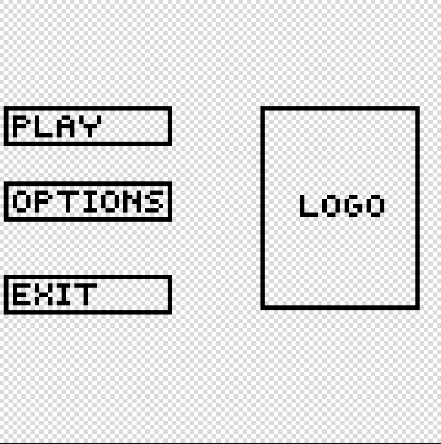

  Options UI layout:
  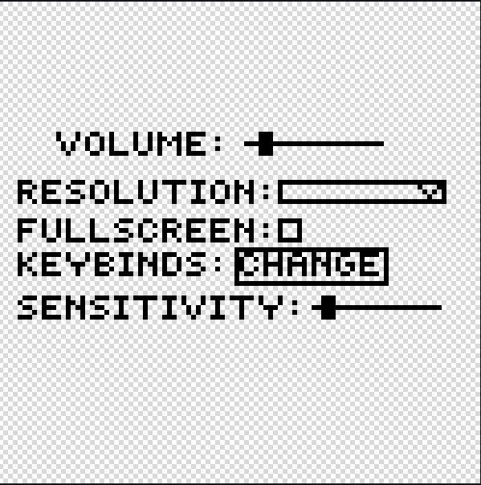

  Level select UI layout:
  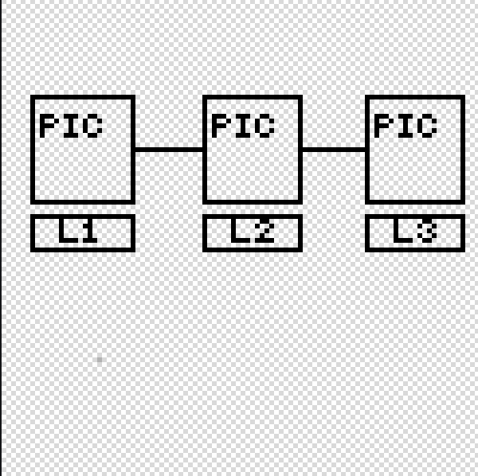

  Loadout select UI layout:
  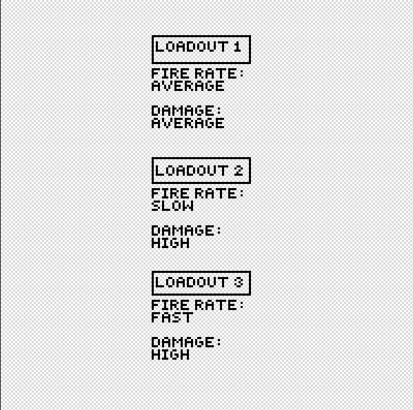

  Game over UI layout:
  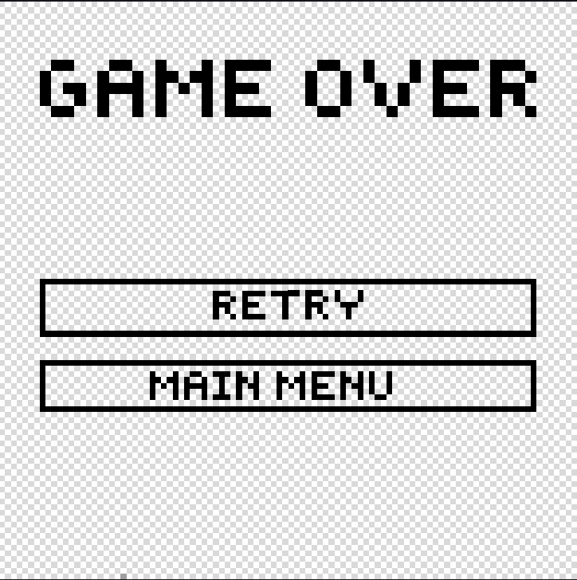

  Level complete UI layout:
  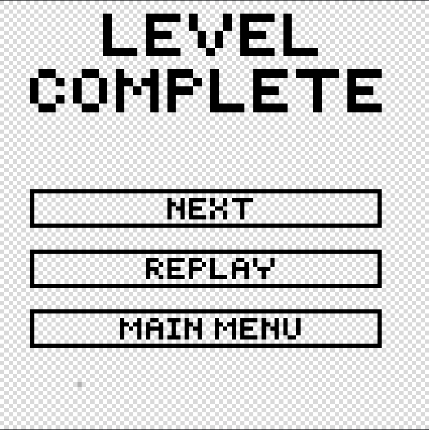

  Game screen UI layout:
  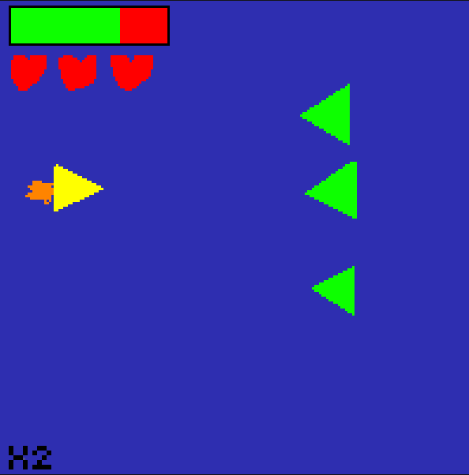
- **UI Flow** - <!-- Models showing menu transition, may be UML but more likely a flowchart or similar. --> 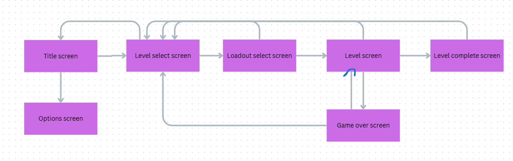

## Technical Specification ##
Key software design elements including: 

- Feature list 
  <!-- - Features / mechanics to be implemented
  - **Use Case** may be used to express these -->
  - Create window
  - Game loop
  - Show screen
  - Spawn bullet
  - Spawn player
  - Spawn NPC
  - Spawn background
  - Detect Player hits NPC
  - Detect bullet hits NPC
  - Detect bullet hits player
  - Read mouse input
  - Read keyboard input
  - Show current lives
  - Show menu
  - Show title screen
  - Move bullet
  - Fire bullet
  - Move NPC
  - Move Player
  - Play game
  - Change resolution
  - Change volume
  - Save file
  - Load file
  - Show health bar
  - Apply powerups
  - Show powerups
  - Kill NPC
  - Kill player
  - Apply checkpoints
  - Choose loadout

- Software Design Diagrams:
    - Architectural Design
      - Class Diagram:
        
      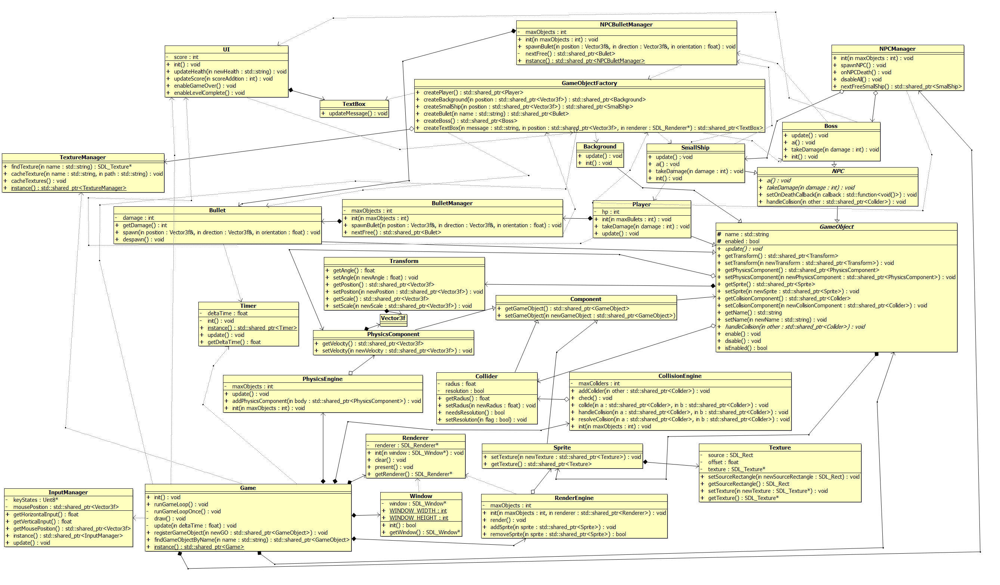
      
    - Mechanistic Design 
      - Game initialisation:
      
      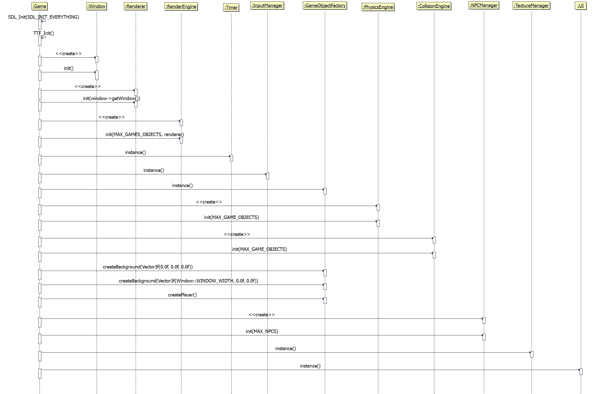

      - Game Loop:
      
      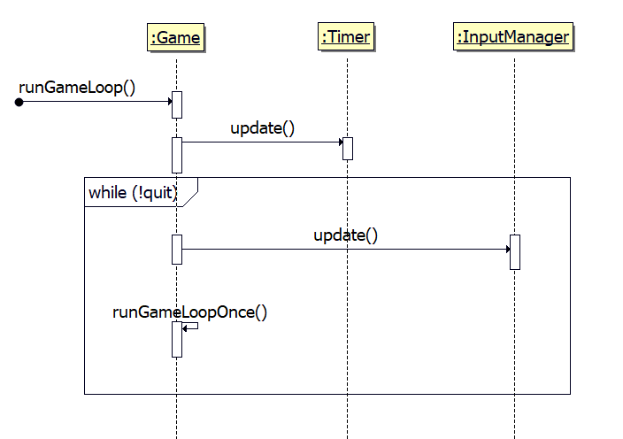
      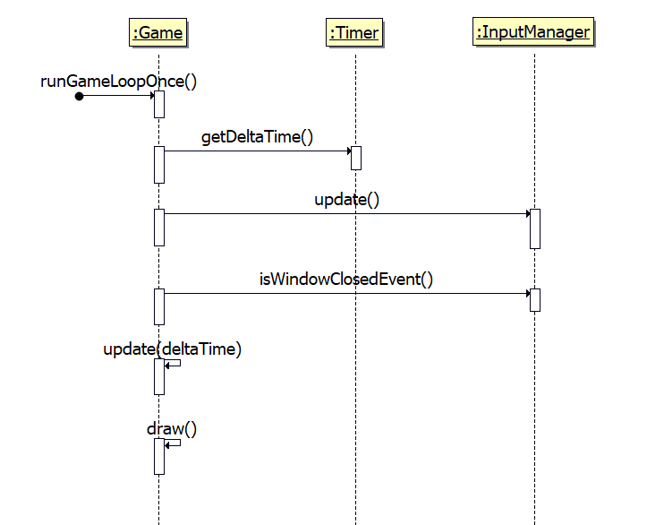
      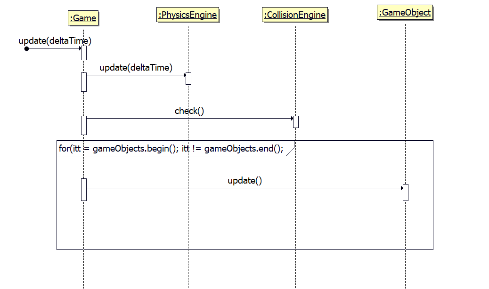
      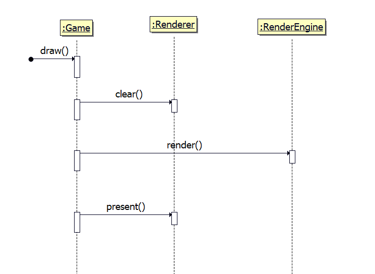

      - NPC spawn:

      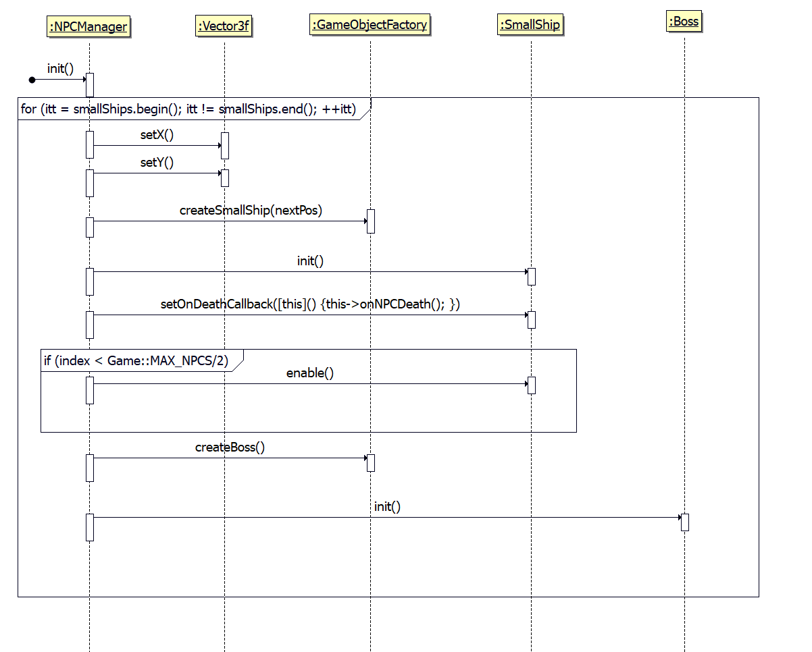
      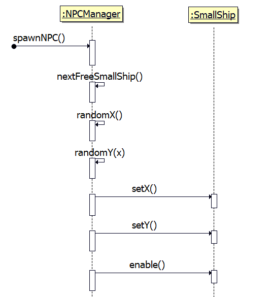

      - Projectile collision with NPC:

      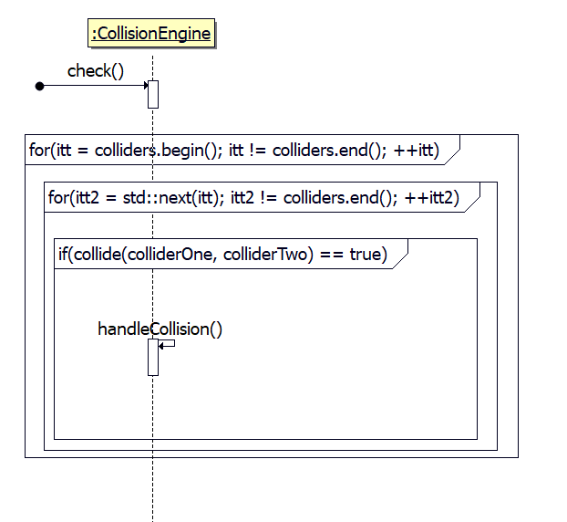
      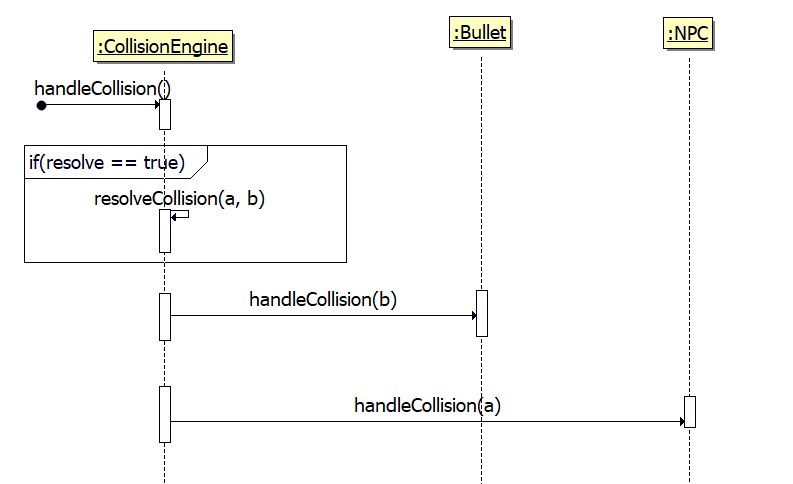
      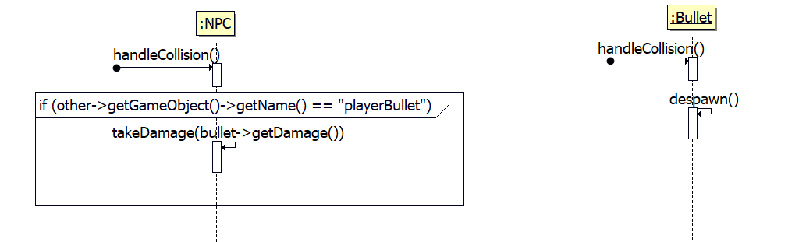
      
        
    - Detailed design 
      - e.g. activity or state chart diagrams as required. 

**Note:** Architectural designs are often found in examples on-line, less so mechanistic design and detailed design which are reserved for documenting complex systems.
 
> Terminology
>
>The terminology here is based on that used by Douglass in "Doing Hard Time".  Architectural design refers to the structural relationships between classes represented using Class and Package diagrams in UML.  Mechanistic design refers to the interaction of runtime entities in performing particular behaviours represented using sequence diagrams.  Finally detailed design is reserved for complex sequences of actions (Activity Diagrams) or state changes (State Chart Diagrams) performed by individual objects. 
>

## Coding Conventions ##

 <!-- Conventions for headers, variable and method names etc. These will be specific to the language being used for the game, and the in house practices of the company. -->

Attributes - camelCase
Methods - camelCase
Classes - PascalCase
Structures - PascalCase

## Testing Plan ##

 Details of automated tests harnesses (unit, integration and system tests) and results from play-testing undertaken. 
 <!-- Optional -->
- **Automated Tests** - Details of automated test frameworks, mock frameworks etc. and their coverage. 
<!-- Not optional! -->
- **Playtesting** - Overview of the kinds of tests, e.g. player control, combat, puzzle etc. and individuals responsible. 
- **Testing Schedule** - Schedule of testing to be undertaken at each milestone, may include both unit tests suites to be complete and early playtesting of mechanics / levels. 

| Type of Test | Milestone | Name | Test Description | Input | Initial State | Output | Final State | Pass / Fail |
| :-- | :-: | :-- | :-- | :-- | :-- | :--|:--| :-: |
| Playtest | 1 | Player Move Up | Move the player forward using the default control scheme. | Up arrow | Level loaded   Player spawned | Player moves up | Player returns to idle state   Player location updated | **Pass** |
| Playtest | 1 | Player Move Left | Move the player left using the default control scheme. | Left arrow | Level loaded   Player spawned | Player moves left | Player returns to idle state   Player location updated | **Pass** |
| Playtest | 1 | Player Move Down | Move the player down using the default control scheme. | Down arrow | Level loaded   Player spawned | Player moves down | Player returns to idle state   Player location updated | **Pass** |
| Playtest | 1 | Player Move Right | Move the player right using the default control scheme. | Right arrow | Level loaded   Player spawned | Player moves right | Player returns to idle state   Player location updated | **Pass** |
| Playtest | 1 | Player Move Up and Right | Move the player up and right using the default control scheme. | Up and right arrow | Level loaded   Player spawned | Player moves up and right| Player returns to idle state   Player location updated | **Pass** |
| Playtest | 1 | Player Move Up and Left| Move the player up and left using the default control scheme. | Up and left arrow | Level loaded   Player spawned | Player moves up and left| Player returns to idle state   Player location updated | **Pass** |
| Playtest | 1 | Player Move Down and Left| Move the player down and left using the default control scheme. | Down and left arrow | Level loaded   Player spawned | Player moves down and left| Player returns to idle state   Player location updated | **Pass** |
| Playtest | 1 | Player Move Down and Right| Move the player down and right using the default control scheme. | Down and right arrow | Level loaded   Player spawned | Player moves down and rigth| Player returns to idle state   Player location updated | **Pass** |
| Playtest | 1 | Aim with mouse | Change the direction the player is aiming using the mouse | Move the mouse around | Level loaded   Player spawned | Player looks in a different direction | Player returns to idle state   Player angle update | **Pass** |
| Playtest | 1 | Moving background | Let the background move and wrap around to the other edge of the screen | N/A | Background spawned | Both background objects move and wraps round to the other side of the screen to create the illusion of a scrolling background | Background is moving | **Pass** |
| Playtest | 1 | NPC spawning | A bunch of NPCs will spawn at random X and Y positions offscreen | N/A | Level Loaded Player Spawned | A bunch of NPCs spawn at random X and Y positions offscreen | NPCs are spawned | **Pass** |
| Playtest | 2 | Shoot bullet | Bullet spawns at player's position | Left Mouse Button | Level loaded   Player spawned | Bullet spawns at player's position | Bullet is on screen | **Pass** |
| Playtest | 2 | Leave bullet to move | Bullet moves in direction player was facing | N/A | Level loaded   Player spawned   Bullet Spawned| Bullet is moving | Bullet moves in direction player was facing | **Pass** |
| Playtest | 2 | Leave bullet for length of TTF | Leave bullet for length of TTF | N/A | Level loaded   Player spawned   Bullet moving | Bullet disables | Level loaded   Player spawned | **Pass** |
| Playtest | 2 | Bullet hits an NPC | A bullet collides with an NPC's collider | N/A | Level loaded   Player spawned   Bullet moving   NPC Spawned | Bullet disables and does 10 damage to NPC | Level loaded   Player spawned   NPC Spawned | **Pass** |
| Playtest | 2 | Bullet kills NPC | A bullet collides with an NPC's collider when it has 10 hp left | N/A | Level loaded   Player spawned   Bullet moving   NPC Spawned | Bullet and NPC disables and score text updates by +20 | Level loaded   Player spawned | **Pass** |
| Playtest | 2 | Small Ship respawn | When Small Ship dies a new one respawns | N/A | Small Ship dead | A new Small Ship from the vector of Small Ships is enabled and spawns at a random position offscreen | Small Ship respawned | **Pass** |
| Playtest | 2 | NPC looks towards player | NPC looks towards player | N/A | Player Spawned   NPC moving | The angle of the sprite is updated to match the direction the player is | NPC angle updated | **Pass** |
| Playtest | 2 | NPC bullet fire | A bullet spawns from NPC | N/A | Player Spawned   NPC moving | A bullet is spawned at the position of the NPC and moves in the direction it is facing when the cooldown reaches 0 | NPC Bullet spawned | **Pass** |
| Playtest | 2 | Player takes damage | Enemy bullet colliders with player's collider | N/A | Bullet is colliding with Player | 10 hp is removed from the Player, the bullet is disabled and the Health text updates with the new HP value | Player returns to normal with 10 less hp | **Pass**
| Playtest | 2 | Enemey bullet kills player | A bullet collides with the player's collider when they have 10 hp left | N/A | Bullet is colliding with player | The player is disabled | Player is disabled | **Pass** |
| Playtest | 2 | All enemies despawn | When the player kills 20 small ships they all despawn | N/A | 19 have been killed | All small ships are disabled | All small ships are disabled | **Pass** |
| Playtest | 2 | Boss spawns | The boss spawns after all small ships are despawned and it is moving forward | N/A | Enemies are despawned | Boss is enabled and it is given a velocity towards the left of the screen | Boss is moving towards the left | **Pass** |
| Playtest | 2 | Boss stops moving | The boss stops moving when its X position is the width * 0.6 | N/A | Boss is moving | Boss' speed is set to 0 | Boss is idle | **Pass** |
| Playtest | 2 | Boss dies | A bullet collides with the boss when it is 10 hp | N/A | Boss is idle | Boss is disabled and level complete text appears | Level is over | **Pass** |

## Examples ##

There are few examples of TDDs online, possibly as these are often included in a single document (bible,) including both GDD and TDD.  

[Unholy Roses](https://hell-and-back.fandom.com/wiki/Technical_Design_Document)

[Unity Tutorial Example](http://game-lab.alliance-artem.fr/wp-content/uploads/2021/01/Zombie-Toys-Technical-Design-Document.pdf)
